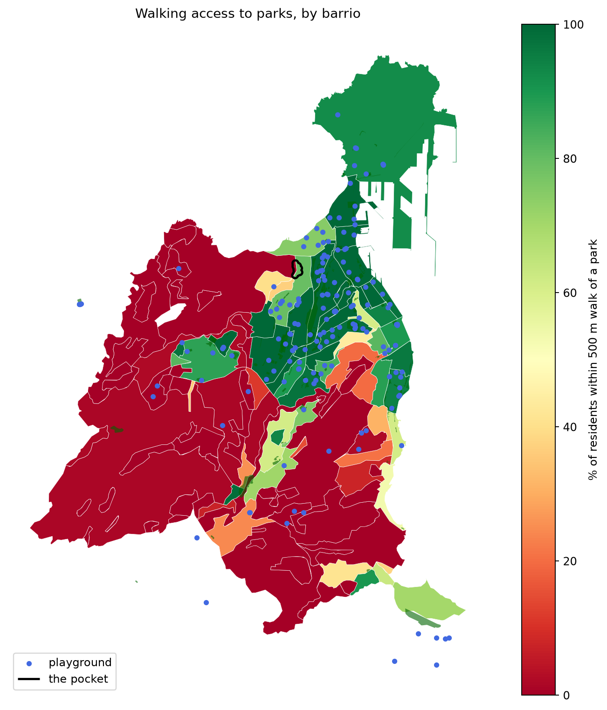

# Park access around Carretera de Chile and Calle Doctor Alfonso Chiscano Díaz

Oct 17, 2026 · @Gabor Varga

## Summary

About 2,000 residents in 816 homes along Carretera de Chile and Calle Doctor Alfonso Chiscano Díaz live more than 1 km on foot from the nearest public park and almost 900 m from the nearest playground. That places them among the worst-served 12% of residents in Las Palmas de Gran Canaria.

Next to these homes sit Las Palmeras Golf, a 9.2 ha municipal golf course that is not open to the public as a park, and an abandoned plot where a wellness centre was started and never finished.

| Measure (pocket of 26 apartment buildings, 816 homes) | Value |
| --- | --- |
| Median walk to nearest public park (≥ 2,500 m²) | 1,145 m |
| Median walk to nearest playground | 877 m |
| City residents with a park closer than the middle of the pocket | 88.7% |
| City residents with a playground closer than the middle of the pocket | 87.7% |

We ask the Ayuntamiento to turn the abandoned plot (0.38 ha) and a strip of the municipal golf course along Calle Doctor Alfonso Chiscano Díaz (0.55 ha, about 6% of the course) into a free public park with a playground. Together they would put every home in the pocket within 500 m of a park and give about 6,400 people across the city a park within 500 m.

## Context

The area studied is the northern edge of the barrio of Las Torres, around Carretera de Chile and Calle Doctor Alfonso Chiscano Díaz. Residents often call it the Negrín area, after the nearby hospital; official statistics (ISTAC) count it as part of Las Torres.

Immediately east of the homes lies [Las Palmeras Golf](https://www.1golf.eu/es/club/las-palmeras-golf-club/), an 18-hole par-3 course at Avenida Doctor Alfonso Chiscano Díaz s/n, founded in 2006. It is part of a sports centre that also has a spa, gym, pool and paddle courts ([Hello Canary Islands](https://www.hellocanaryislands.com/golf-courses/gran-canaria/las-palmeras-golf/)). It is the largest open green space near these homes, but it is a paid sports facility, not a public park.

**The golf course land is municipal.** The course is a municipal sports facility run through the Instituto Municipal de Deportes (IMD) ([Ayuntamiento](https://www.laspalmasgc.es/es/areas-tematicas/deportes/palinstalacion/Complejo-Deportivo-Las-Palmeras-Golf/)).

- **2002:** the Ayuntamiento granted a 50-year concession to build and run it to Las Palmeras Golf Park S.L.U., a subsidiary of Evemarina, which later went bankrupt.
- **November 2015:** the Ayuntamiento paid €4.1 million to the insolvency administrators to regain full control ([eldiario.es](https://www.eldiario.es/canariasahora/politica/palmas-gran-canaria-millones-palmeras_1_2379700.html)). The planning councillor said about €7 million in unpaid fees, water and maintenance was owed to the city, and that it had not decided whether to keep the golf use ([eldiario.es](https://www.eldiario.es/canariasahora/politica/ayuntamiento-lpgc-puerta-campo-ballena_1_2288285.html)).
- **May 2022:** the IMD granted the Federación Canaria de Golf a 15-year concession, extendable by 5. Revenue must be reinvested in the facility, public use must be guaranteed, and the Ayuntamiento keeps the right to take back use of the site at any time ([Ayuntamiento](https://www.laspalmasgc.es/es/ayuntamiento/prensa-y-comunicacion/notas-de-prensa/nota-de-prensa/El-IMD-rubrica-la-concesion-del-Complejo-Las-Palmeras-Golf-y-de-las-pistas-de-padel-a-las-federaciones-canarias-de-ambos-deportes/), [Las Palmeras Golf](https://laspalmerasgolf.es/noticias/108-el-imd-rubrica-la-concesion-del-complejo-las-palmeras-golf-durante-quince-anos-a-la-federacion-canaria-de-golf-.html)).

**"Public use" means open to anyone who pays to play.** An 18-hole round is listed at €28.80, with reduced rates for children, students and over-65s ([1golf.eu](https://www.1golf.eu/it/club/las-palmeras-golf-club); prices may have changed). Like any golf course, it is not a place where non-players can walk or children can play. Public ownership has not given the neighbourhood a public green space.

Because the land is public and the city kept the right to recover it, setting aside part of it as a park is a decision the Ayuntamiento can take. Its classification in the Plan General still needs to be confirmed.

**Beside the course is an abandoned plot.** Between the two halves of the course, next to the car park it shares with the golf club, lies a 0.38 ha plot. Neighbours report that a wellness centre was started there and abandoned when the developer went bankrupt; we found no published record of that project. The plot is not part of the course as mapped. The municipal sports complex is listed at 111,648 m² ([Ayuntamiento](https://www.laspalmasgc.es/es/areas-tematicas/deportes/palinstalacion/Complejo-Deportivo-Las-Palmeras-Golf/)), about 2 ha more than the 9.2 ha course, so the plot may belong to the municipal site. This needs checking in the Catastro.

**The city has committed to child-friendly public space.** Las Palmas de Gran Canaria has been a UNICEF Child-Friendly City (*Ciudad Amiga de la Infancia*) since 2021 ([Ayuntamiento](https://www.laspalmasgc.es/es/ayuntamiento/prensa-y-comunicacion/notas-de-prensa/nota-de-prensa/El-Ayuntamiento-reune-al-consejo-de-la-Infancia-y-la-Adolescencia-tras-conocer-que-Las-Palmas-de-Gran-Canaria-sera-Ciudad-Amiga-de-la-Infancia/)) and renewed the recognition in April 2026 ([RTVC](https://rtvc.es/cinco-municipios-canarios-renuevan-como-ciudades-amigas-de-la-infancia-16-abril-2026/)). Its II Plan Municipal de Infancia y Adolescencia 2025–2028, approved by the city council in May 2025, proposes creating parks and sports areas adapted to the needs of children and adolescents ([Canarias7](https://www.canarias7.es/canarias/gran-canaria/las-palmas-de-gran-canaria/siga-directo-pleno-ayuntamiento-palmas-gran-canaria-20250528225417-di.html)).

The pocket is exactly where that commitment is missing: a neighbourhood of apartment blocks, averaging more than 30 homes per building, home to many young families, with no park within a kilometre on foot and no playground within 750 m.

## Method

We measured, for every residential building in the city, the walking distance along real streets and paths to the nearest public park and the nearest playground. All data are open and the analysis can be repeated by anyone.

- **Parks:** OpenStreetMap areas tagged as park, garden, recreation ground or village green, of at least 2,500 m². Private or residential gardens and the golf course are excluded. Results were repeated with minimum sizes of 1,000 and 5,000 m².
- **Playgrounds:** OpenStreetMap playgrounds, excluding those tagged as private.
- **Walking network:** OpenStreetMap streets, footpaths and stairs. Distance is measured to the edge of the park, which slightly favours the current situation. Streets are sampled every 20 m, and a park can be entered from any street point within 30 m of its edge.
- **Residents:** the number of homes in each building comes from the Catastro's open buildings dataset. Residents are estimated at 2.5 people per home; the count includes any empty or second homes.
- **Barrios:** official boundaries from the Instituto Canario de Estadística (ISTAC, 2018 edition), with 2024 barrio names.
- **The pocket:** the connected group of homes, starting from a home in the middle of Carretera de Chile, where both the nearest park and the nearest playground are more than 750 m away on foot. Buildings within 150 m of each other count as one group. The group was found by the analysis, not drawn by hand.

## Findings

The homes along Carretera de Chile and Calle Doctor Alfonso Chiscano Díaz form a clear pocket with no park or playground within a reasonable walk, inside a barrio that is otherwise well served.

**1. The pocket is among the worst-served places in the city.** From a home in the middle of the pocket, on Carretera de Chile, the nearest public park is a 1,100 m walk and the nearest playground 921 m. 88.7% of the city's residents live closer to a park, and 87.7% closer to a playground.

**2. About 2,000 people live in it.** The Catastro records 816 homes in the pocket's 26 residential buildings. By nearest street, 24 buildings are on Carretera de Chile, 1 on Calle Doctor Alfonso Chiscano Díaz and 1 on El Horno de Cal. At 2.5 people per home that is about 2,000 residents; the count includes any empty or second homes.

**3. No home in the pocket is within 750 m of either.** The median walk is 1,145 m to a park and 877 m to a playground. The worst-placed building is 1,247 m from a park and 1,124 m from a playground.

**4. Barrio averages hide the pocket.** Las Torres as a whole has 79% of residents within 500 m of a park and ranks 74th of 106 barrios (1 = worst). Its gap is concentrated at the northern edge: 14% of Las Torres residents are more than 1 km from a park, and the pocket is where they live.

| Area | Residents within 500 m of a park | Median walk to a park |
| --- | --- | --- |
| The pocket | 0% | 1,145 m |
| Las Torres (whole barrio) | 79% | 154 m |
| Whole city | 77% | – |

## Where a park could go

The abandoned plot plus a strip of the golf course along Calle Doctor Alfonso Chiscano Díaz would bring every home in the pocket within 500 m of a park, using about 6% of the course. We modelled the whole course and two areas drawn by residents: the abandoned plot and a strip between Calle Doctor Alfonso Chiscano Díaz and the course's ball-stop net.

| Area turned into a public park | Size | Golf course land used | Pocket: median walk to a park | Pocket homes within 500 m | People citywide gaining a park within 500 m |
| --- | --- | --- | --- | --- | --- |
| Today | – | – | 1,145 m | 0% | – |
| **Proposed: abandoned plot + residents' strip** | **0.93 ha** | **6%** | **258 m** | **100%** | **\~6,400** |
| Abandoned plot only | 0.38 ha | none | 369 m | 74% | \~5,200 |
| Residents' strip only | 0.55 ha | 6% | 258 m | 100% | \~4,900 |
| Whole golf course | 9.2 ha | 100% | 220 m | 100% | \~8,000 |

- **The residents' strip is the practical choice.** Only a low fence separates it from the pavement of Calle Doctor Alfonso Chiscano Díaz, and the tall net that stops balls from the driving range already runs along its eastern side. It holds four small practice putting greens. On its own it brings every home in the pocket within 500 m of a park, with a median walk of 258 m.
- **The abandoned plot reaches the most people.** It uses no golf land and gives about 5,200 people across the city a park within 500 m, many of them in the neighbourhood north of the course. On its own it covers three quarters of the pocket.
- **Together they serve both areas.** The plot and the residents' strip cover 0.93 ha, of which 0.53 ha is golf land. About 6,400 people across the city would gain a park within 500 m.
- **The whole course is the upper bound.** Opened as a park, it would raise the share of the city's residents within 500 m of a park from 77.4% to 79.4%.

People counts are Catastro homes × 2.5 people. Each area is assumed to be entered from every street point within 30 m of its edge. The residents' strip would replace the four practice greens; whether they can move elsewhere on the course needs discussing with the club.

## Limitations and open checks

The core finding is robust to the choice of minimum park size, but four points must be checked before these numbers are presented as final.

- [ ] **Missing paths.** Walking routes come from OpenStreetMap. If a staircase or path exists that the map lacks, real walking distances would be shorter. Walk the route from Carretera de Chile towards the nearest park and record it.
- [ ] **Private playgrounds.** Some mapped playgrounds may be inside gated residential complexes. If so, real access is worse than reported.
- [ ] **Resident counts.** Homes come from the Catastro; residents assume 2.5 people per home and include any empty or second homes. INE population by census section, including its share of children under 15, would firm up the resident figures and show how many children live in the pocket.
- [ ] **Golf course land.** The land is municipal and under a concession to the Federación Canaria de Golf since 2022. Still unknown: the full concession terms, current municipal spending on the site, the land's classification in the Plan General, and whether the abandoned plot next to the car park is part of the municipal site (check in the Catastro).

Other notes: barrio boundaries are the 2018 ISTAC edition, and ISTAC has no barrio called Negrín, so the area appears under Las Torres. The barrio comparison uses 106 barrios with at least 30 residential buildings.

## What we ask and next steps

We ask the Ayuntamiento de Las Palmas de Gran Canaria for three things, in order of how quickly they can be done.

1. **A park and playground on the abandoned plot and a strip of the golf course.** Turn the abandoned plot next to the golf car park (0.38 ha) and a strip of the municipal golf course along Calle Doctor Alfonso Chiscano Díaz, between the street and the existing ball-stop net (0.55 ha, about 6% of the course), into a public park with a children's playground, open every day and free of charge.
2. **A direct entrance from our streets.** The new park must be entered from the residential side, so families do not have to walk around the course to reach it.
3. **Information.** The headline terms of the 2022 concession are public. We ask for the details that decide how easily part of the site can be recovered: the contract text, including the conditions and any compensation if the city takes back part of the site; what the city has spent on the site since 2015; how the Plan General classifies the site; and who owns the abandoned plot next to the car park (requested under the right of access to public information).

Next steps for neighbours:

- [ ] Verify the four open checks above
- [ ] Gather signatures and contacts from residents of the pocket
- [ ] Contact the local residents' association and the district board
- [ ] File the information request and the formal instancia with this study attached

The analysis, maps and code are available on request so the Ayuntamiento's technical staff can reproduce every figure.

**Sources:** OpenStreetMap contributors (parks, playgrounds, walking network, October 2026); Dirección General del Catastro, INSPIRE buildings (homes per building, October 2026); ISTAC barrio boundaries 2018 and barrio classification 2024 ([datos.canarias.es](https://datos.canarias.es/catalogos/general/dataset/clasificacion-de-barrios-de-principales-municipios-de-canarias-para-el-ano-2024-istac-cl_b-20241)); [Las Palmeras Golf, 1golf.eu](https://www.1golf.eu/es/club/las-palmeras-golf-club/); [Las Palmeras Golf, Hello Canary Islands](https://www.hellocanaryislands.com/golf-courses/gran-canaria/las-palmeras-golf/).
